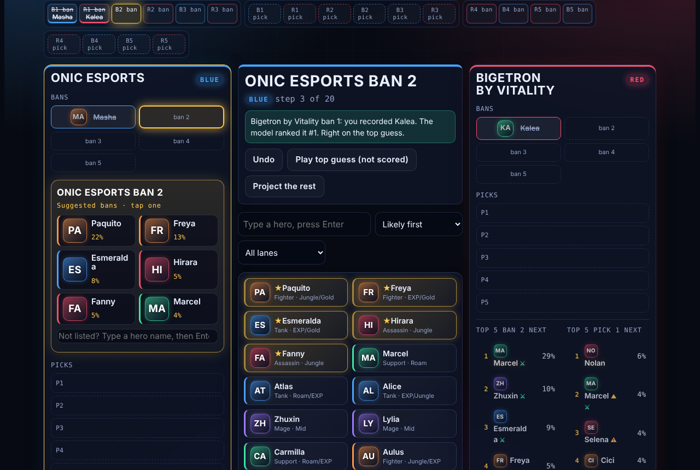
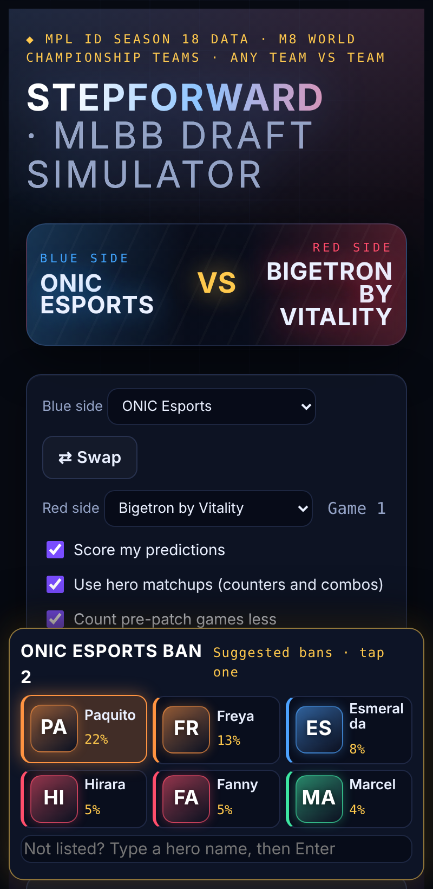

# StepForward · MLBB Draft Predictor

[](https://github.com/YOUR-USERNAME/stepforward/actions/workflows/ci.yml)

**Live app: https://stepforward-mlbb-draft-simulator.netlify.app/**

StepForward guesses what a **Mobile Legends: Bang Bang (MLBB)** pro team will **ban or pick next**, explains why, and scores itself against what really happened. Built for the **M8 World Championship** (Wild Card in Bangkok from 17 Dec 2026, Main Stage in Istanbul to 23 Jan 2027).

> **Explain it like I'm 12:** before each pro game, the two teams take turns banning and choosing heroes, like picking players before a match. Fans like to guess the next move. StepForward learns each team's habits from its past games and ranks the most likely heroes for the next turn.





## What it does

- **Predicts the next ban or pick** for any of 24 teams (M8 teams and MPL Indonesia teams), step by step through the 20-step draft.
- **Quick-pick box:** the top suggestions appear right under the slot being filled. One tap records a hero and jumps to the next step; or type a name and press Enter.
- **Gives reasons** for each suggestion (team habit, meta, playoff change, counter, combo, denial, lane limits).
- **Scores itself:** record what really happened and see how highly the model ranked it.
- **Honest about limits:** win prediction is about a coin flip, and the app says so. Teams without data are labelled.
- Extra pages: [formulas and accuracy](site/formulas.html), [drafter habits](site/habits.html), [programs and source](site/programs.html).

## How accurate is it? (walk-forward tests: each game predicted only from earlier games)

| Test | Result | Random guess |
|---|---|---|
| Real ban is the model's #1 guess | ~23% | ~1% |
| Real ban is in the model's top 5 | ~49% | ~5% |
| Win prediction (54 games) | 31 of 54 right (57%): about a coin flip | 50% |

*Ban rows: the last 800 ban steps of Season 18, each predicted only from earlier games (could be 3-4 points higher or lower). On the 270 playoff ban steps alone it was about 24% and 53%. The same numbers appear in the app under "How accurate is it?".*

Details, formulas and confidence ranges: `site/formulas.html`. The AI is statistics and machine learning (no LLM): recency-weighted team frequencies shrunk toward a league prior, Bayesian Bradley-Terry team strength, and a logistic win model.

## Run it

```bash
git clone https://github.com/YOUR-USERNAME/stepforward.git
cd stepforward
npm test            # 16 unit tests, no packages to install (Node 20+)
npm run build       # rebuilds site/index.html from src/ and data/
npx serve site      # or just open site/index.html in a browser
```

Python engine (optional, trainable on new CSV data):
```bash
cd engine
pip install numpy scipy pytest      # catboost is optional
python -m pytest -q                 # 22 tests
```

## Project map

| Path | What is in it |
|---|---|
| `spec.md` | AI capability, inputs, outputs, testable acceptance criteria, architecture summary |
| `docs/` | Validation report, PRD, architecture, reflection, demo script, submission checklist |
| `src/` | `model.js`, `sim.js`, `comp.js`, `bt.js`, `explain.js` and the UI template |
| `scripts/build.js` | Builds `site/index.html` |
| `data/` | Game records, research notes, tuned parameters, accuracy results |
| `engine/` | Python logistic regression / CatBoost engine and tests |
| `tests/` | Node unit tests (draft rules, ban model, statistics, data checks, secret scan) |
| `.github/workflows/ci.yml` | Tests → build check → secret scan → deploy |
| `CLAUDE.md`, `.cursorrules` | Instructions for AI coding assistants |

## CI/CD and secrets

On every push GitHub Actions runs the JavaScript tests, rebuilds the site and fails if the committed `site/index.html` is out of date, runs the Python tests, and scans for leaked secrets. On `main`, if the two repository secrets below exist, it deploys `site/` to Netlify.

| Secret (GitHub → Settings → Secrets and variables → Actions) | Where to get it |
|---|---|
| `NETLIFY_AUTH_TOKEN` | Netlify → User settings → Applications → Personal access tokens |
| `NETLIFY_SITE_ID` | Netlify → Site configuration → Site details → Site ID |

The app itself needs **no** secrets (see `.env.example`). Nothing sensitive is committed.

## Data and credits

Draft and result data come from public tournament pages read by hand (MPL Indonesia S18, MPL Malaysia S18, MPL Philippines playoffs), with sources noted in `data/research/` and `docs/`. No scraping. Regions without readable drafts are not modelled.

**Unofficial fan project.** Mobile Legends: Bang Bang, hero names and team names belong to Moonton and the teams. Not affiliated with or endorsed by Moonton. Hero pictures are not bundled; badges show initials unless image links are supplied in `data/hero_img.json`.

## Roadmap

- v1.1: real-user feedback fixes, hero pictures (with permission)
- v2: AI explainer (server-side key), automatic data refresh, more regions as drafts are published

License: MIT.
