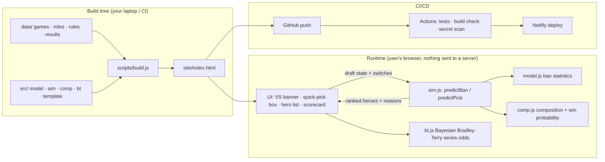

# Architecture notes

## 1. System at a glance

## 2. Layers

| Layer | Files | Responsibility |
|---|---|---|
| UI | `src/index.template.html` | Rendering, events, local state (saved in the browser's localStorage if allowed), quick-pick box, charts |
| AI layer | `src/sim.js` | Draft rules, ranking of every hero for the next step, reasons, lane feasibility, ban-shift |
| Models | `src/model.js`, `src/comp.js`, `src/bt.js` | Pure functions, no DOM, run the same in Node (tests) and the browser |
| Data | `data/` | Dated game records, hero roles and traits, matchup rules, tuned parameters, accuracy results |
| Build | `scripts/build.js` | Reads data, computes derived tables (team hierarchies, pools, regions), injects everything into one HTML file |
| Python engine | `engine/` | Trainable logistic regression / CatBoost for win probability and "best next pick", with 22 unit tests |
| CI/CD | `.github/workflows/ci.yml` | Test, check the built file is up to date, scan for secrets, deploy `site/` |

## 3. The AI module in detail

**Ban model** (`model.js` + `sim.js:predictBan`)
1. Take every earlier game of the team on the clock. Weight it: newer is heavier (`decay`), same side is heavier, same opponent is heavier (`h2hW`), games before the latest patch count less, and a small time decay applies.
2. Frequency of each hero in those weighted games, mixed with a league-wide prior so small samples cannot mislead (`k` pseudo-games). The prior itself blends regular-season and playoff ban shares (playoff prior, β = 0.5).
3. Blend with the frequency at this ban position (first ban vs fifth ban behave differently).
4. Nudge with matchup rules, drop heroes the opponent cannot play because no lane is free, normalise to sum 1.

**Pick model** (`sim.js:predictPick`): the team's and the active player's hero pools, then ban-shift (when a hero is banned, part of its chance moves to the same player's other heroes and same-lane heroes), matchup and combo rules, and denial (taking what the other side needs).

**Win model** (`comp.js`, `bt.js`): a logistic blend of team strength, hero evidence, composition and side, clamped to 35-65%; series odds from a Bayesian Bradley-Terry sampler with a fixed seed. Measured as about a coin flip on 54 games; the UI says so.

**Evaluation:** walk-forward only. For game *i* the model sees games 0…i-1. Metrics: top-1 / top-3 / top-5 hit rate, mean log-score, bootstrap intervals. Results live in `data/results/` and are shown on `site/formulas.html`.

| Test | Result (held-out, walk-forward) |
|---|---|
| Ban top-1 / top-5, last 800 Season-18 ban steps | ~23% / ~49% (random ≈ 1% / 5%); on the 270 playoff steps alone ~24% / ~53% |
| Log-score with no / ID+PH / ID+PH+MY playoff prior | −3.520 → −3.365 → −3.317 (higher is better) |
| Win prediction, 54 games | Best logistic 0.676 vs coin flip 0.693 log-loss; 95% range includes "no skill" |

## 4. Data provenance

Draft records come from public tournament pages read by hand (no scraping): MPL Indonesia S18 (198 games), MPL Malaysia S18 (105 games, playoff prior). Hero roles, lanes and traits come from research notes in `data/research/`. Regions with no readable draft pages (Türkiye, CIS, Myanmar, MENA) are **not** modelled and the app says so.

## 5. Security and secrets

- Static site: there is no server to attack and no database.
- No API keys exist in the repo. `tests/data.test.js` and the CI secret-scan job guard against accidents.
- Deploy credentials (`NETLIFY_AUTH_TOKEN`, `NETLIFY_SITE_ID`) live only in GitHub repository secrets, read through `${{ secrets.* }}` in the workflow.
- If an LLM feature is added: call it from a serverless function so the key never reaches the browser.

## 6. Decisions and trade-offs

| Decision | Why | Cost |
|---|---|---|
| Statistical models, not an LLM, for prediction | Needs dated numbers and honest accuracy tests; an LLM would guess and could not be back-tested | Less flexible explanations (planned v2: LLM only to *explain* the model's output) |
| Everything in the browser | Free hosting, instant, private, easy demo | One big HTML file; data refresh needs a rebuild |
| Single-file page built from a template | Easy to deploy anywhere | Harder to navigate than many small files |
| Walk-forward tests, small honest claims | Prevents fooling ourselves | Numbers look modest |
